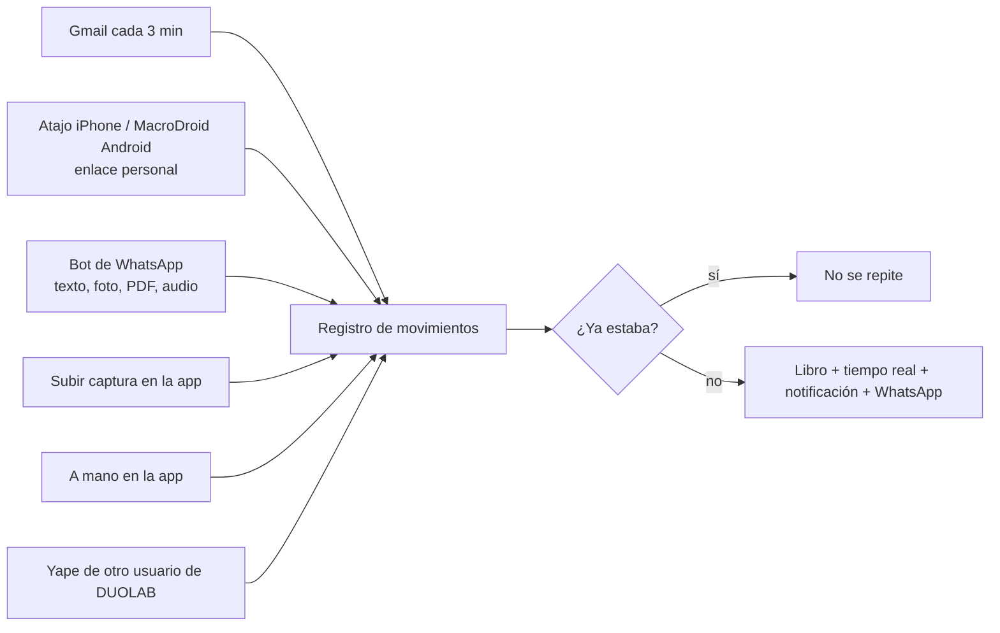

# 02 · Registro automático de movimientos

La app recibe movimientos por seis caminos. Todos terminan en el mismo registro, que evita duplicados y avisa a la app abierta en tiempo real.

## 1. Gmail

- Cada persona vincula uno o varios Gmail (hasta 5) en **Mi cuenta → Gastos desde tu Gmail**. Solo se pide permiso de lectura.
- Se revisa **cada 3 minutos** (variable `GMAIL_MINUTOS`), también con la app cerrada. Mientras hay un Gmail activo, el servidor se mantiene despierto en Render.
- Solo se abren correos de remitentes financieros y con palabras de pago (filtro `FILTRO` en `server/google.js`).
- Cada correo se lee así, en este orden (los lectores fijos van primero: registran aunque la IA esté caída o se equivoque):
  1. **Correos de Yape** («Acabas de yapear»): lector exacto (`server/yape.js`). Toma monto, quién yapeó, beneficiario, fecha y hora.
  2. **Consumo con tarjeta** («Realizaste un consumo de S/ X en …»), de cualquier monto.
  3. **Avisos de Yape y Plin** («Yapeaste», «te envió un pago», «te plinearon»).
  4. **Avisos de banco o billetera con una operación explícita** (`avisoFinancieroSinIa`): «Realizaste un pago», «Transferiste», «Recibiste un abono»…, hasta S/ 3,000. Nunca registra compras o traslados de deuda, pagos de tarjeta, préstamos ni transferencias entre cuentas propias.
  5. **IA** (Claude o NVIDIA, según Admin → IA) para todo lo demás. Si la IA falla, el correo no se marca como revisado y se reintenta en la siguiente vuelta.
- **Diagnóstico de hoy** (Mi cuenta → Gmail): avisos de pago de las últimas 24 horas en cada Gmail y qué pasó con cada uno (registrado, descartado con su motivo, pendiente), con «Volver a revisar»; además el estado de la IA, del bot de WhatsApp y del último envío del teléfono.
- **Escaneo de correos anteriores**: en Mi cuenta se puede escanear el último mes, 3, 6, 12, 24 meses, todo el correo o unas fechas. Avanza por tandas de 100 avisos.
- **Correos revisados**: en Mi cuenta se ve qué se hizo con cada aviso de la última semana y se puede **Volver a revisar** uno que no se registró.

### Quién paga y quién recibe en un correo de Yape

Yape solo envía correo a **quien paga**. Para decidir si el correo es un gasto o un ingreso en la cuenta que lo lee:

1. Si el WhatsApp de la cuenta termina en los mismos 3 dígitos que el **celular del beneficiario** → **ingreso** «Yapeo de <quien pagó>».
2. Si termina como **«Tu número de celular»** → **gasto** «Yapeo a <beneficiario>».
3. Si no hay celular, por los nombres (Yape recorta: «Franko Val*»).

Por eso **cada cuenta debe tener su WhatsApp guardado** en Mi cuenta.

### Yape entre dos personas que usan DUOLAB

**Requisitos:** quien paga usa DUOLAB con el Gmail donde le llegan los correos de Yape; quien recibe usa DUOLAB con su **WhatsApp guardado**; y solo un usuario coincide con esos 3 dígitos (o el nombre desempata). Si no, no se registra nada.

**Casos que no cubre:** si quien paga ya había anotado ese Yape **a mano en la app** antes de que llegue el correo, el correo se descarta por duplicado y al beneficiario no se le registra. (Si lo anotó por captura, atajo o WhatsApp, sí: ese camino también avisa al beneficiario, con nombre.)

**Cómo comprobarlo:** quien paga yapea S/ 1 a quien recibe; en unos 3 minutos aparece el gasto en una cuenta y el ingreso «Yapeo de…» en la otra. Si no, Mi cuenta → Gmail → Diagnóstico de hoy en la cuenta de quien pagó.

Cuando el correo de Yape se registra como gasto en la cuenta de quien pagó, la app busca al beneficiario entre los usuarios por los 3 últimos dígitos de su WhatsApp (y el nombre si hay varios). Si hay exactamente uno, le registra el **ingreso** y le avisa por notificación («💜 X te yapeó S/ Y») y WhatsApp. Si hay duda, no registra nada.

También funciona cuando quien paga registra su Yape o Plin **por captura, atajo, WhatsApp o aviso del teléfono**: en ese caso se exige que el **nombre** del beneficiario («Franko Val*») coincida con un único usuario (y los 3 dígitos del celular si se ven). Un nombre ambiguo o solo un número enmascarado no registran nada.

### Pagos que te hacen (ingresos)

- **Correos de banco:** «Recibiste un abono», «Abono recibido», «Transferencia recibida», «Te han depositado», «Te plinearon», «Recibiste un yapeo»… se registran como ingreso sin IA, de cualquier monto.
- **Notificaciones del teléfono (Android/MacroDroid):** «JUAN te envió un pago por S/ 25», «¡Te yapearon S/ 3.50!» → ingreso.
- **Capturas de Yape:** las filas con «+ S/» (en verde) son ingresos.
- **Yape no envía correo a quien recibe:** sin teléfono ni captura, un Yape recibido solo se registra si quien paga usa DUOLAB.

## 2. Enlace personal del teléfono (`/api/avisos/<token>`)

Cada persona crea su enlace en **Mi cuenta → Yape, Plin y avisos del teléfono**. No debe compartirse: con él se registran movimientos en su cuenta.

- **Android (automático): MacroDroid** reenvía cada notificación de Yape, Plin o del banco como texto. Se lee sin IA cuando el formato es conocido y con IA si no.
- **Android con la app DUOLAB de Play Store** (cuando se publique): lee las notificaciones sola, sin MacroDroid. El APK de la web no puede (Play Protect lo bloquearía). Ver [android/LEEME.md](../android/LEEME.md).
- **iPhone (automático al abrir Yape):** el atajo «DUOLAB Yape» se ejecuta solo cada vez que se abre Yape (también al tocar la notificación «Te yapearon»): espera 6 segundos, captura la lista de movimientos y la envía con `?silencioso=1`. Apple no deja que ninguna app lea las notificaciones de otra, así que en iPhone hace falta abrir Yape (un toque). Ver [03 · Guías](03-guias.md) y [10 · iPhone, Android y apps nativas](10-ios-android.md).
- **Modo silencioso (`?silencioso=1`):** si no se registró nada nuevo (pantalla de la clave de Yape, captura sin movimientos, todo ya registrado), la respuesta llega con `mensaje` vacío y código 200, para que el atajo no muestre ninguna notificación. En **Últimos envíos** queda como «Captura (automático)».
- El enlace acepta texto, JSON, imagen (con o sin tipo), formulario o PDF.
- La respuesta siempre trae `mensaje` (lo que muestra la notificación del atajo), también con el motivo cuando algo falla.
- Cada envío queda en **Mi cuenta → Últimos envíos** (7 días): hora, origen, cuántos se registraron o por qué falló.

## 3. Capturas (atajo, WhatsApp o botón «Subir captura»)

- La IA lee la imagen: listas de movimientos («Hoy», «Ayer», números enmascarados «*** *** 266», «Plin - NOMBRE»), constancias, boletas, vouchers y PDF. Incluye montos pequeños.
- Antes de enviarla a la IA, la imagen se reduce y comprime (`server/imagen.js`): NVIDIA acepta unos 180 KB y una captura de iPhone pesa 2-4 MB.
- En la app, **Subir captura** muestra lo encontrado y deja elegir qué registrar; lo que ya está en el libro viene desmarcado.
- La misma captura enviada dos veces se reconoce por su huella y no se vuelve a leer.

## 4. Bot de WhatsApp

- Reconoce a la persona por su número guardado en Mi cuenta.
- **Tono:** respuestas cortas, como un mensaje entre personas (casi siempre de 1 a 4 líneas, sin introducciones ni resúmenes, como mucho una pregunta corta). Se adapta al estilo de quien escribe: formal (de usted), neutro o suelto con jerga y emojis; por defecto cercano y tuteando. Siempre respetuoso: no se burla, no juzga ni da sermones. Si la persona solo quiere conversar, conversa con naturalidad sin llevar todo a las finanzas. Las reglas están en `INSTRUCCIONES` de `server/ia.js`.
- Las confirmaciones de registro también son breves: «_Responde a este mensaje para corregirlo o anularlo._».
- Registra frases («gasté 30 en taxi», varias líneas a la vez), fotos, PDF y audios (con `GROQ_API_KEY` u `OPENAI_API_KEY`).
- Para corregir, se **responde** al mensaje del bot: «era ingreso», «son 30», «fue ayer», «anúlalo». «deshacer» borra lo último.
- Responde preguntas con la IA y envía el estado de cuenta o el PDF.

## Cómo se evitan los duplicados

| Situación | Regla |
| --- | --- |
| Pago con hora (lista de Yape, correo de Yape) | Huella `fecha|hora|tipo|monto`: el mismo pago no se repite; dos pagos iguales a distintas horas se registran los dos. |
| Correo frente a algo anotado a mano, por WhatsApp o captura | Mismo tipo y monto con un día de diferencia como mucho = el mismo. |
| Dos correos con el mismo monto | Solo son el mismo si la descripción se parece (dos avisos del mismo pago); si no, son dos operaciones. |
| Notificación del teléfono repetida | El mismo texto en 3 minutos cuenta una vez. |
| Lo escrito por WhatsApp | Solo se evita el doble envío accidental (mismo texto en 3 minutos). |

## Límites conocidos

- **Yape no envía correo a quien recibe.** Los Yapes recibidos solo llegan por el teléfono (atajo, MacroDroid) o si quien paga también usa DUOLAB.
- **El correo de Yape va al correo registrado en la app de Yape**, que puede no ser el Gmail vinculado.
- **iPhone:** ninguna app puede leer las notificaciones de Yape; el atajo se dispara al abrir Yape (tocar la notificación basta). Si Yape tarda más de 6 segundos en mostrar los movimientos, esa vez no registra nada (se recupera la próxima vez que se abra Yape, porque la lista muestra los últimos movimientos).
- **Costo de IA:** cada apertura de Yape con el atajo automático envía una captura a la IA.
- La lectura de capturas y de correos ambiguos necesita la IA activada (Admin → IA).
