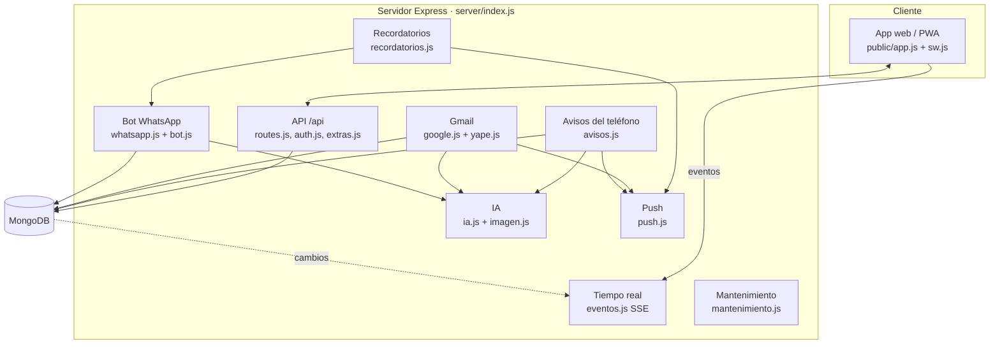

# 05 · Arquitectura

## Tecnologías

| Parte | Tecnología |
| --- | --- |
| Servidor | Node.js ≥ 20, Express 5, módulos ES |
| Base de datos | MongoDB (Atlas) con Mongoose 8 |
| WhatsApp | Baileys (WhatsApp Web) |
| IA | Anthropic SDK (Claude) o API de NVIDIA; Whisper (Groq/OpenAI) para audios |
| Imágenes | sharp (reducir capturas antes de la IA) |
| PDF | pdfkit (informes) y unpdf 1.8.1 (leer PDF) |
| Notificaciones | web-push con claves VAPID |
| Seguridad | helmet, express-rate-limit, sesiones JWT en cookie, contraseñas con bcrypt |
| App | Una página en JavaScript sin framework (`public/app.js`), service worker (`public/sw.js`), manifiesto PWA |

## Cómo encajan las partes

## Módulos del servidor (`server/`)

| Archivo | Qué hace |
| --- | --- |
| `index.js` | Arranque: Express, cabeceras, rutas, conexión a la base, correcciones únicas y tareas periódicas. `/api/version`. |
| `config.js` | Lee las variables de entorno. |
| `db.js` | Conexión a MongoDB (o una local si no hay datos). |
| `models.js` | Esquemas y colecciones (tabla abajo). Avisa a `eventos.js` cuando cambian los movimientos. |
| `auth.js` | Registro, entrada, sesión, perfil, recuperación de contraseña, recordatorio por persona. |
| `routes.js` | Libros, movimientos, mes, pendientes, resumen, miembros, informe PDF, envíos, capturas, IA en la app. |
| `extras.js` | Metas de ahorro y categorías con presupuesto. |
| `google.js` | Entrar con Google, vincular Gmail, revisión cada 3 min, escaneo, correos revisados, lectores sin IA, recuperación de avisos. |
| `yape.js` | Lector exacto de correos de Yape y registro al beneficiario que usa la app. |
| `avisos.js` | Enlace personal del teléfono: notificaciones, capturas, PDF; historial de envíos. |
| `whatsapp.js` | Conexión del bot, mensajes entrantes (texto, foto, PDF, audio), envíos. |
| `bot.js` | Lógica del bot: registrar, varios a la vez, corregir, anular, preguntas, huellas anti-duplicados. |
| `ia.js` | Llamadas a Claude o NVIDIA: chat, lectura de correos, comprobantes y capturas. |
| `imagen.js` | Reduce y comprime imágenes para la IA; extrae archivos de formularios. |
| `medios.js` | Detecta el medio de pago (Yape, Plin, tarjeta…) y el banco. |
| `recordatorios.js` | Recordatorios de pago por WhatsApp y push. |
| `push.js` | Claves VAPID, suscripciones y envío de notificaciones. |
| `eventos.js` | Canal en tiempo real (Server-Sent Events) hacia la app abierta. |
| `mantenimiento.js` | Compactación, limpieza diaria y tamaños por colección. |
| `informe.js` | Genera el PDF con el logo. |
| `cambio.js` | Tipo de cambio para cobros en otra moneda. |
| `correo.js` | Envío de correos (Cloudflare, Brevo o SMTP). |
| `licencias.js` | Comprobación de licencias de VIMOD. |
| `admin.js` | Rutas del panel Admin. |
| `errores.js` | Errores HTTP y validación de textos. |

## Colecciones de la base de datos

| Colección | Guarda | Caducidad |
| --- | --- | --- |
| `usuarios` | Cuentas, WhatsApp, Gmail vinculados (tokens cifrados), enlace de avisos, ajuste de recordatorios | — |
| `libros` | Libros, moneda, miembros y categorías con presupuesto | — |
| `movimientos` | Gastos e ingresos (con medio, banco, recordatorio, huella, correo de origen) | — |
| `metas` | Metas de ahorro con sus aportes | — |
| `suscripcionpushes` | Dispositivos con notificaciones activadas | — |
| `ajustes` | Ajustes del administrador, claves VAPID, correcciones ya hechas | — |
| `sesionwas` | Sesión y claves del bot de WhatsApp | — |
| `correovistos` | Correos ya revisados, avisos y capturas ya recibidos | 45 días |
| `correorevisados` | Qué se decidió con cada correo | 8 días |
| `mensajebots` | Mensajes del bot y los movimientos que confirman (para corregir respondiendo) | 45 días |
| `avisorecibidos` | Últimos envíos al enlace personal | 7 días |

## API (resumen)

Todas bajo `/api`, con sesión salvo las indicadas.

| Prefijo | Rutas principales |
| --- | --- |
| `/auth` | `POST registro, login, logout, olvide, restablecer` · `GET/PATCH yo` · `POST app/canjear` (código de un solo uso de la app Android) |
| `/auth/google` | Entrar con Google (`?app=android` vuelve a la app), `app/enlace-gmail` (código de 5 min para vincular Gmail desde la app), `callback`, `estado`; `gmail` (vincular, pausar, desvincular), `gmail/revisar`, `gmail/escanear`, `gmail/revisados` |
| `/libros` | `GET/POST /libros`; en `/libros/:id`: `mes`, `movimientos`, `pendientes`, `resumen`, `miembros`, `informe.pdf`, `enviar`, `capturas`, `capturas/registrar`, `metas`, `categorias` |
| `/avisos` | `enlace` (sesión) · `historial` (sesión) · `atajo` (sesión: enlace de iCloud del atajo) · `POST /:token` (sin sesión, para el teléfono; `?silencioso=1` responde sin mensaje si no hay nada nuevo) |
| `/push` | `clave`, `suscribir`, `prueba` |
| `/eventos` | Canal de tiempo real (SSE) |
| `/ia` | `estado`, `chat`, `whatsapp` |
| `/recordatorios/prueba` | Mensaje de prueba |
| `/admin` | `almacenamiento`, `usuarios`, `whatsapp`, `ia`, `atajo` (`GET/PUT`, enlace de iCloud del atajo) (solo administradores) |
| `/version` | Versión publicada (sin sesión) |

Fuera de `/api`: `GET /.well-known/assetlinks.json` (huella de la app Android, para abrirla sin barra de direcciones).

## App web (`public/`)

| Archivo | Qué es |
| --- | --- |
| `index.html` | Estructura, menú, formularios y barra inferior |
| `app.js` | Toda la lógica: vistas, gráficas, ventanas, instalación, notificaciones, gestos, tiempo real |
| `styles.css` | Estilos por capas (tema claro y oscuro, adaptación a cada ancho) |
| `sw.js` | Service worker: abre al instante desde la copia guardada, se actualiza por detrás y recibe notificaciones. La versión de caché (`nfta-gastos-vNN`) sube en cada cambio. |
| `manifest.webmanifest` | Nombre, iconos y colores de la app instalada |
| `logo-duolab*.png`, `icons/`, `favicon.ico` | Logos e iconos |
| `privacidad.html`, `terminos.html` | Páginas legales |
| `videos/tutorial-atajo-iphone.mp4` (+ `.jpg` de portada) | Video tutorial del atajo de iPhone (1:43, 1080×1920, voz «Camila»). El service worker no lo guarda en caché: Safari pide los videos por partes (Range). |

## App Android (`android/`)

App **nativa** en Kotlin con Jetpack Compose que usa la misma API (cookie `sesion` guardada en el teléfono). Dos versiones: `web` (APK en `/descargas/duolab-gastos.apk`, sin lectura de notificaciones) y `play` (Play Store, con `LecturaAvisos`). El acceso con Google abre Chrome en `/api/auth/google?app=android` y vuelve con `duolab://login?codigo=…`, que la app canjea en `POST /api/auth/app/canjear`. Ver [android/LEEME.md](../android/LEEME.md).

## Herramientas (`herramientas/`)

| Carpeta | Qué hace |
| --- | --- |
| `video-atajo/` | Regenera el video tutorial: `guion.json` (texto de cada escena), `voz.py` (voz neuronal con edge-tts → WAV), `video.py` (dibuja las pantallas con Pillow y monta el MP4 con ffmpeg). Ver su `LEEME.md`. |

## Pantalla de inicio (diseños)

`pintarMes` arma la pantalla con bloques (tarjeta del mes, totales, próximo mes, pestañas, lista de pendientes, últimos movimientos) y los ordena según el diseño elegido (`localStorage` `disenoInicio`: `auto`, `clasico`, `resumen`, `pagos`, `simple`). `disenoRecomendado` elige el automático según pendientes y número de movimientos. Ver [01 · Funciones](01-funciones.md#diseño-de-la-pantalla-de-inicio).
